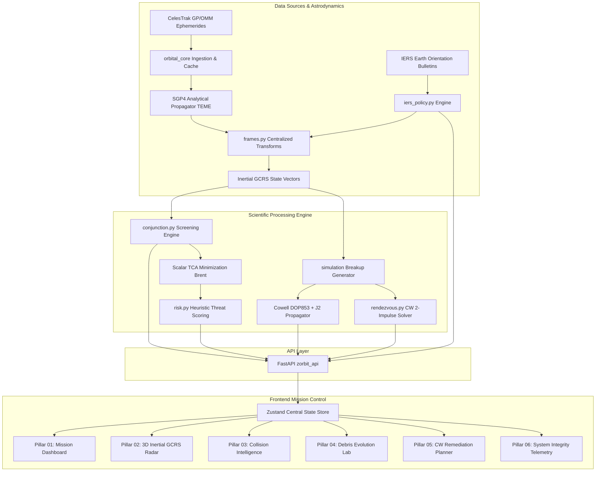

# COLLIVRA

> **See the risk. Secure the orbit.**

**COLLIVRA** is an open-architecture Space Situational Awareness (SSA) and Orbital Sustainability decision-support platform engineered for real-time conjunction screening, high-risk close approach analysis, synthetic debris fragmentation modeling, and Clohessy-Wiltshire active debris removal (ADR) remediation planning.

Developed by **Team Errorists** for **ASTRA 2026 — VIT Bhopal**.

---

## 1. Problem Statement

Low Earth Orbit (LEO) is experiencing exponential asset growth from mega-constellations and commercial satellites alongside tens of thousands of unmaneuverable debris fragments. This crowded orbital environment poses critical challenges:
- **Orbital Congestion and Cascading Collision Risks:** High relative closing velocities (~10 to 15 km/s) mean even millimeter-sized debris can inflict catastrophic kinetic impacts, risking runaway Kessler syndrome cascades.
- **Data Fidelity vs. Analytical Misrepresentation:** Public orbital ephemerides (TLE/OMM) do not provide calibrated positional error covariance matrices ($\mathbf{C}_1, \mathbf{C}_2$). Presenting heuristic risk indices as formal collision probabilities ($P_c$) misinforms operators and erodes trust in safety analyses.
- **Operational Fragmentation:** Satellite operators and space sustainability teams often contend with disjointed tools for orbital tracking, conjunction screening, debris modeling, and remediation planning.
- **Reference Frame Ambiguities:** Inconsistent handling of celestial and terrestrial reference systems (e.g., confusing SGP4's native TEME frame with inertial GCRS or rotating frames) induces severe geometrical errors.

COLLIVRA solves these challenges by unifying the full lifecycle—from asset monitoring to conjunction screening, risk triage, synthetic fragmentation, and remediation trajectory optimization—into an integrated mission-control platform built upon rigorous, transparent astrodynamics.

---

## 2. Core Capabilities (The Six Pillars)

COLLIVRA organizes space situational awareness into six interconnected operational pillars:

1. **Pillar 01 — Mission & Orbital Overview:** Real-time asset inventory, orbital regime categorization (LEO, MEO, GEO), constellation tracking, and strategic SSA telemetry.
2. **Pillar 02 — Orbital Environment Explorer:** High-performance 3D visualization rendering Earth in inertial Geocentric Celestial Reference System (GCRS) with accurate axial tilt and Greenwich Apparent Sidereal Time (GAST) diurnal rotation, preventing artificial orbital plane rotation.
3. **Pillar 03 — Collision Intelligence:** Automated all-pairs conjunction screening with coarse time-step bracketing and fine Time of Closest Approach (TCA) numerical minimization, accompanied by an explainable Heuristic Risk Index $[0.0 - 1.0]$.
4. **Pillar 04 — Debris Evolution Laboratory:** Simplified synthetic fragmentation engine modeling isotropic kinetic breakup, mass distribution, physical momentum residual tracking ($\sum m_i \Delta \mathbf{v}_i = \mathbf{0}$), and Cowell numerical orbit integration with $J_2$ Earth oblateness.
5. **Pillar 05 — Mitigation & Sustainability:** Active Debris Removal (ADR) trajectory planning using analytical Clohessy-Wiltshire (Hill/RIC) two-impulse rendezvous solutions and fuel $\Delta v$ budgeting for near-circular chief orbits.
6. **Pillar 06 — System & Data Integrity:** Strict Earth orientation policy enforcement governing IERS Bulletins A/B parameter freshness, data source provenance tracking (`LIVE`, `CACHE`, `OFFLINE_FIXTURE`, `SYNTHETIC`), and automated health monitoring.

---

## 3. Technology Stack

### Frontend & Visualization
- **Framework:** Next.js 14 (App Router)
- **Language:** TypeScript 5.4
- **UI & State:** React 18, Tailwind CSS, Lucide React, Zustand 4.5
- **3D Graphics:** Three.js 0.164, React Three Fiber (R3F) 8.16, Drei 9.105
- **Data Visualization:** Recharts 2.12
- **Testing Engine:** Sucrase Node with custom astrodynamics test harness

### Backend & Scientific Computing
- **API Framework:** FastAPI 0.111, Uvicorn 0.30, Pydantic v2 (2.7+)
- **Orbital Propagation & Frames:** SGP4 2.23, Astropy 6.0, ERFA, NumPy 1.26, SciPy 1.12
- **Numerical Integration:** SciPy `solve_ivp` with Runge-Kutta / DOP853 algorithms
- **Database & Services:** PostgreSQL 16 (via Docker Compose) with SQLAlchemy 2.0
- **Testing:** Pytest 8.0, Pytest-Asyncio, HTTPX

---

## 4. System Architecture



---

## 5. Repository Structure

```text
COLLIVRA/
├── README.md                      # Public project documentation & runbook
├── docker-compose.yml             # PostgreSQL 16 service definition
├── pyproject.toml                 # Root Python monorepo configuration
├── requirements.txt               # Development dependencies & editable package links
├── apps/
│   ├── api/                       # FastAPI application service
│   │   ├── pyproject.toml         # API package metadata & dependencies
│   │   ├── README.md              # Backend documentation
│   │   └── zorbit_api/            # Application source code
│   │       ├── main.py            # API entry point, lifespan, & IERS policy setup
│   │       └── routers/           # Conjunction, remediation, & risk endpoints
│   └── web/                       # Next.js 14 frontend mission control
│       ├── package.json           # Frontend dependencies and scripts
│       ├── run-tests.ts           # Automated frontend test runner
│       ├── public/                # Static assets and Earth textures
│       └── src/
│           ├── app/               # Next.js App Router entry point & layout
│           ├── components/        # UI components for all 6 pillars
│           ├── lib/               # Astrodynamics utilities & API client
│           ├── store/             # Zustand state management
│           └── types/             # TypeScript interfaces & URN schemas
├── packages/
│   ├── orbital_core/              # Core astrodynamics library
│   │   ├── pyproject.toml         # orbital_core package metadata
│   │   └── orbital_core/          # SGP4 propagation, frames, screening, & IERS policy
│   └── simulation/                # Simulation and remediation engine
│       ├── pyproject.toml         # simulation package metadata
│       └── simulation/            # Synthetic breakup, numerical DOP853, & CW solver
├── data/
│   ├── fixtures/                  # Verified offline ephemerides & scenario JSONs
│   └── seeds/                     # Breakup simulation parameters
├── docs/                          # Architecture, scientific models, & user guides
└── tests/
    ├── conftest.py                # Pytest global fixtures
    ├── unit/                      # Backend unit tests
    └── integration/               # Pipeline integration tests
```

---

## 6. Installation & Local Setup

### Prerequisites
- **Python:** 3.11 or higher (Python 3.11 recommended)
- **Node.js:** v18.17.0 or higher (v20+ recommended)
- **npm:** v9+ or higher
- **Git**

### Step 1: Clone or Open the Repository
```powershell
cd C:\Projects\COLLIVRA_RELEASE
```

### Step 2: Set Up Python Virtual Environment
```powershell
# Create virtual environment
python -m venv .venv

# Activate virtual environment (Windows PowerShell)
.\.venv\Scripts\Activate.ps1

# On Linux/macOS:
# source .venv/bin/activate

# Upgrade pip and install all packages in editable mode
pip install --upgrade pip
pip install -r requirements.txt
```

### Step 3: Install Frontend Dependencies
```powershell
cd apps\web
npm install
cd ..\..
```

### Step 4 (Optional): Start Local PostgreSQL via Docker Compose
```powershell
docker compose up -d
```
*Note: COLLIVRA operates seamlessly without Docker by utilizing its built-in in-memory state and validated offline fixtures.*

---

## 7. Running the Application

### 1. Launch the FastAPI Backend
Open a terminal in the repository root:
```powershell
.\.venv\Scripts\Activate.ps1
uvicorn apps.api.zorbit_api.main:app --host 127.0.0.1 --port 8000 --reload
```
*Verification:* Navigate to `http://127.0.0.1:8000/docs` to inspect the interactive Swagger OpenAPI documentation.

### 2. Launch the Next.js Frontend
Open a second terminal in `apps/web`:
```powershell
cd apps\web
npm run dev
```
*Verification:* Open `http://localhost:3000` in a WebGL-compatible browser (Chrome, Edge, Firefox, Brave).

---

## 8. Verification & Automated Testing

COLLIVRA incorporates rigorous automated verification across both mathematical engines and frontend interfaces.

### Backend Test Suite (Pytest)
Run from the repository root:
```powershell
pytest -q
```
*Verified Result:* **416 / 416 passed**  
Validates SGP4 orbital propagation, Vallado TEME-to-GCRS benchmark vectors, IERS Bulletin A/B policy validation, bounded scalar TCA numerical minimization, synthetic fragmentation mass/momentum conservation, and Clohessy-Wiltshire two-impulse solutions.

### Frontend Test Suite (Astrodynamics & UI Harness)
Run from `apps/web`:
```powershell
cd apps\web
npm test
```
*Verified Result:* **431 / 431 passed** across 24 test suites  
Validates inertial coordinate display mapping, non-extrapolation time scrubbers, runtime API contract guards, URN normalization, Indian space ecosystem data models, and the 7-step operational workflow.

### Code Quality & Build Checks
```powershell
cd apps\web
npx tsc --noEmit     # TypeScript type safety check (0 errors)
npm run lint         # ESLint check (0 warnings, 0 errors)
npm run build        # Production Next.js build (4/4 static routes generated)
```

---

## 9. Scientific Methodology & Modeling Assumptions

### Coordinate Reference Systems & Astrodynamics
1. **Raw SGP4 Output is TEME:** SGP4 analytical propagation yields Cartesian state vectors in the True Equator, Mean Equinox (TEME) frame of epoch. COLLIVRA never equates TEME to inertial GCRS or terrestrial ITRS.
2. **Centralized Transformations (`frames.py`):** Coordinates traverse IAU 2006/2000A standard reduction paths using ERFA routines. Transformations are verified against David Vallado's benchmark test suite (AIAA-2006-6753).
3. **Inertial 3D Earth Alignment:** The Three.js world frame is strictly aligned with inertial GCRS ($X_{\text{Three}} = X_{\text{GCRF}}$, $Y_{\text{Three}} = Z_{\text{GCRF}}$, $Z_{\text{Three}} = -Y_{\text{GCRF}}$). Earth rotates according to Greenwich Apparent Sidereal Time $\theta_{\text{GAST}}(t)$; orbital planes remain stationary in space.

### Conjunction Screening & TCA Minimization
- **Pairwise Elimination:** Screening evaluates unique unordered pairs $(i, j)$ with $0 \le i < j < N$.
- **Continuous TCA Search:** Candidate close approaches identified on a discrete time grid are refined using bounded scalar minimization (Brent's method) directly on the Euclidean distance function $d(t) = \|\mathbf{r}_2(t) - \mathbf{r}_1(t)\|$, which is invariant under orthogonal frame rotations.

### Synthetic Breakup Simulation
- **Mass & Momentum Conservation:** Generates synthetic debris fragments with user-specified total parent mass and maximum ejection $\Delta v$. Center-of-mass velocity drift $\Delta \mathbf{v}_{\text{cm}} = \frac{\sum m_i \Delta \mathbf{v}_i}{\sum m_i}$ and residual momentum $\sum m_i \Delta \mathbf{v}_i$ are explicitly reported.
- **Numerical Propagation:** Cartesian fragment states are propagated using SciPy's DOP853 (Runge-Kutta 8(5,3)) integrator incorporating Earth's gravitational potential with $J_2$ oblateness perturbations ($\mu_E = 398600.4418\text{ km}^3/\text{s}^2$, $J_2 = 1.08262668 \times 10^{-3}$, $R_E = 6378.137\text{ km}$).

### Clohessy-Wiltshire (CW) Remediation Solver
- **Hill / LVLH Frame Dynamics:** Linearized equations of relative motion solve for two-impulse transfers ($\Delta \mathbf{v}_1$ at transfer departure, $\Delta \mathbf{v}_2$ at rendezvous arrival).
- **Near-Circular Precondition:** Strictly requires chief orbit eccentricity $e < 0.005$. Infeasible configurations or excessive fuel requirements ($\Delta v > 50\text{ m/s}$) are flagged with visual badges.

---

## 10. Scientific Limitations & Honest Disclosures

To maintain scientific integrity (AGENTS.md §3), COLLIVRA enforces strict transparency:

1. **Heuristic Risk vs. Probability of Collision ($P_c$):** Public TLE/OMM ephemerides do **not** supply positional error covariance matrices ($\mathbf{C}_1, \mathbf{C}_2$). COLLIVRA explicitly reports a **Heuristic Threat Index $[0.0 - 1.0]$** based on Euclidean miss distance, closing speed, and encounter geometry. It **never** disguises heuristic scores as formal collision probabilities ($P_c$).
2. **Simplified Synthetic Breakup:** The debris simulation is an educational and research proxy model. It does not claim compliance with the complete NASA Standard Breakup Model (NASA SBM) area-to-mass or power-law fragment distributions. All simulated debris fragments carry `is_synthetic: true` flags and synthetic identifiers (`SYNTH-FRAG-xxxx`).
3. **Atmospheric Interface Crossing:** The 100 km altitude boundary indicates orbital reentry interface crossing into the dense atmosphere; it is not a thermodynamic aerothermal burnup simulation and does not guarantee complete demise.
4. **Clohessy-Wiltshire Linearization:** The CW solver assumes linearized relative motion in an unperturbed Keplerian field. It is designed for short-range decision support (transfer durations under 2 orbital periods) and should not be used as an operational flight guidance solution.
5. **Deterministic Offline Demonstration Data:** To ensure zero-failure demonstration reliability without external network latency or CelesTrak rate-limiting, COLLIVRA includes verified offline ephemeris snapshots in `data/fixtures/`. These snapshots are clearly labeled as `OFFLINE_FIXTURE` in the UI and telemetry panels.

---

## 11. Data Sources & Attribution

- **CelesTrak (Dr. T.S. Kelso):** General Perturbations (GP) Orbital Mean-Elements Messages (OMM) in JSON format.
- **IERS (International Earth Rotation and Reference Systems Service):** Earth orientation parameters, $\Delta UT1$, and polar motion ($x_p, y_p$) via Astropy IERS tables.
- **Indian Space Ecosystem & IS4OM Alignment:** Constellation architectures for NavIC (IRNSS), Cartosat/EOS, RISAT, and GSAT are integrated via documented CelesTrak group mappings (`isro`, `navic`) with genuine `INTEGRATION_READY` empty states, strictly adhering to scientific policy prohibiting fabricated orbital elements.

---

## 12. Team & Project Information

**Team Errorists — ASTRA 2026, VIT Bhopal**

- **Pranjal Bhatnagar** — Backend Architecture, Orbital Mechanics, Coordinate Frames (`frames.py`, `iers_policy.py`), Conjunction Screening Engine & API Integration
- **Mahi Gupta**        — Frontend Architecture, Next.js 14 Application Shell, 3D Inertial GCRS Radar Canvas, Celestial Shaders & Responsive Mission Control UI
- **Aarushi Raizada**   — Simulation & Remediation Lead, Synthetic Breakup Modeling, Momentum Conservation, Cowell DOP853 Propagation & Clohessy-Wiltshire Relative Motion Solver

----

## 13. License

No open-source license has been assigned to this project yet. All rights reserved.

